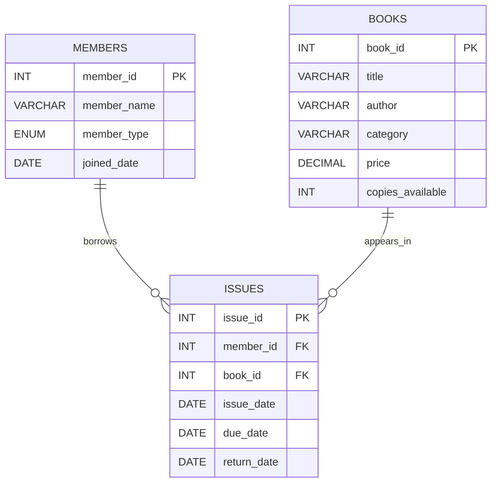

# C1 — Entity Relationship Diagram

Use this relationship layout when drawing the ERD on paper.

## Cardinality

- **MEMBERS to ISSUES:** one-to-many (1:N). A member may have zero or many issue records; each issue record belongs to one member.
- **BOOKS to ISSUES:** one-to-many (1:N). A book may appear in zero or many issue records; each issue record refers to one book.

## Keys

- Primary keys: `members.member_id`, `books.book_id`, `issues.issue_id`.
- Foreign keys: `issues.member_id` references `members.member_id`; `issues.book_id` references `books.book_id`.

The assignment asks for the ERD to be drawn on paper. Use this as the reference, draw it by hand, and include a clear photo or scan in the final submission if required.
